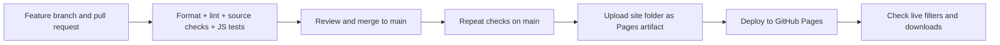

# IPL Analytics Dashboard

An interactive, static dashboard covering **816 IPL matches from 2008–2020**. Explore seasons, teams, venues, batting and bowling performance, then export the selected player summary. This upgrades the original analysis notebook into a reproducible browser application.

## What you can do

1. Choose a season or all seasons, and optionally a team.
2. Compare wins and venue distributions for the chosen match set.
3. Inspect batter runs and bowler wickets with their supporting denominators.
4. Choose a player for their season trend. The player selector changes that trend, not the entire match filter.
5. Download the selected player table as CSV. Team names are kept as recorded; historical rebrands are not silently merged.

The data is historical, not a live scoreboard. Toss/winner association describes observed matches; it does not establish that winning a toss causes a match win.

## Verified data and provenance

The source is [Cricsheet's official IPL JSON archive](https://cricsheet.org/downloads/ipl_json.zip), prepared using `scripts/prepare_data.py`. The downloaded archive contained 1,243 JSON matches when prepared; the stated period filter selected 816. There are **193,468 regulation deliveries** in the selected data. **28 super-over innings are excluded** so their special rules do not mix with regulation statistics.

Archive SHA-256:
`5757e04287179767ff8495f02902bd13812b9572ec8fa2ac1347ec2e9c6d4709`.

The selected records use Cricsheet data version 1.2.0. Player registry identifiers help connect names within the source. Coverage describes this archive, rather than an independent assertion that every official historical scorecard is present.

**Attribution:** match data is provided by Cricsheet under the **Open Data Commons Attribution License (ODC-By) 1.0**. Original notices are in [data/source-notices](data/source-notices), and copies accompany the deployed site. See [Cricsheet licensing](https://cricsheet.org/licensing/). A code repository does not change the source data's license.


## Cricket calculations that matter

| Statistic | Rule used | Why it matters |
|---|---|---|
| Batter runs | Runs credited to the batter | Extras must not inflate batting totals. |
| Balls faced | Deliveries excluding wides | No-balls can still count as a ball faced. |
| Strike rate | `100 × runs / balls faced` | A high rate over a tiny sample is not sustained form. |
| Bowler legal balls | Excludes wides and no-balls | An over is six legal balls, not six recorded deliveries. |
| Runs conceded | Total delivery runs minus byes, leg-byes and penalty extras | Not every team run is the bowler's charge. |
| Bowling economy | `6 × runs conceded / legal balls` | Undefined with no legal balls; overs notation is not a decimal. |
| Bowler wickets | Excludes run-outs, retired hurt/out and obstructing the field | Team dismissals and bowler wickets differ. |
| Toss/win association | Decided matches with matching toss winner and winner | Excludes matches without a result; not a causal experiment. |

For example, `3.2 overs` means 20 legal balls, not 3.2 decimal overs. If 18 runs are conceded in 20 legal balls, economy is `18 × 6 / 20 = 5.4`. A run-out is counted in the match's dismissal events but is not credited as a bowler wicket.

Totals and averages answer different questions. Total runs reward longevity; strike rate measures scoring pace but needs context. Economy ignores wicket value. Venue, era, role, opposition and sample size can confound comparisons. The dashboard presents descriptive statistics, not a player-quality model or match forecast.

## Rebuild the dataset

From the repository root:

```bash
git clone https://github.com/subhashdixit/ipl-analytics-dashboard.git
cd ipl-analytics-dashboard
curl -L https://cricsheet.org/downloads/ipl_json.zip -o /tmp/ipl_json.zip
python3 scripts/prepare_data.py --archive /tmp/ipl_json.zip
python3 scripts/check_data.py
```

A future archive may contain additional matches or corrections. Record its hash and review the resulting difference rather than expecting the current hash to stay constant forever. The preparation code writes only the period-filtered aggregates plus source notices to the site. It is standard-library Python, with no paid sports API.

Data checks validate unique match IDs, player references, period boundaries, nonnegative counts and the reconciliation `batter runs + extras = match runs`. A synthetic delivery fixture checks wides, no-balls, run-outs and excluded super overs independently of the large source file.

Also run the Python parser test:

```bash
python -m pip install pytest==8.4.2
python -m pytest -q tests
```

The original notebook is retained for context. The browser app uses the explicitly rebuilt official dataset, rather than depending on an unavailable notebook-specific local CSV path.

## Run and understand the code

This is a **static application**: HTML provides structure, CSS provides presentation, JavaScript computes the visible analysis and SVG draws charts. It needs no Flask process, model server, API key or database. GitHub Pages can serve these files; it cannot run a Python backend.

Use Python 3.10+ for data checks and a local HTTP server, and Node.js 22+ for the JavaScript tests. Do not open `index.html` using `file://`, because browsers restrict local module/data loading.

```bash
python3 -m venv .venv
source .venv/bin/activate
python -m pip install black==25.1.0 pylint==3.3.8
python -m black --check scripts
python -m pylint scripts
node --test tests/*.test.js
python scripts/check_data.py
python -m http.server 8000 --directory site
```

Open `http://127.0.0.1:8000`. `site/` is the complete deployed website. Data preparation/verification code is in `scripts/`, tests in `tests/`, and the original report/notebook remains outside the deployed artifact. Text is inserted through safe DOM APIs; charts and controls are keyboard-accessible HTML/SVG with responsive layouts. Browser filtering is not server-side data storage.

## GitHub Pages release pipeline



The repository workflow `.github/workflows/pages.yml` tests PRs but only publishes from `main`. Set **Settings → Pages → Source → GitHub Actions**. In Actions, verify `Build and test` and `Deploy to GitHub Pages`. The deployment creates the public HTTPS website from the exact static artifact.

**CI** runs checks automatically when code changes. It catches data corruption, arithmetic regressions and syntax mistakes before release; it does not prove the historical source is correct. **CD** publishes the checked artifact. Least-privilege workflow permissions distinguish reading source, uploading an artifact and deploying Pages. Action dependencies are pinned to reviewed commit hashes.

GitHub is the source-code host; Pages is the static website host. A deployment changes the version visitors receive. There is no Docker requirement here: a browser already supplies the runtime. Adding a Python container would require a separate server host and adds no benefit to this app's calculation.

**Versioning and rollback:** each Git commit versions data and code together. Tag a known-good revision. Revert a bad change in a PR and let the same workflow publish the restored content. A repository rename changes the project Pages URL, so update README/homepage links afterwards. Pages and client caches may take a short time to refresh. Keep source and data notices in the deployed artifact.

The app is historical and has no live ingestion schedule. To update it, explicitly review new source coverage, change the data preparation/transcription, run the checks, and publish a new version. No paid service or secret is required for this public static deployment. Read [GitHub Pages documentation](https://docs.github.com/en/pages/getting-started-with-github-pages/what-is-github-pages) for current service limits.
